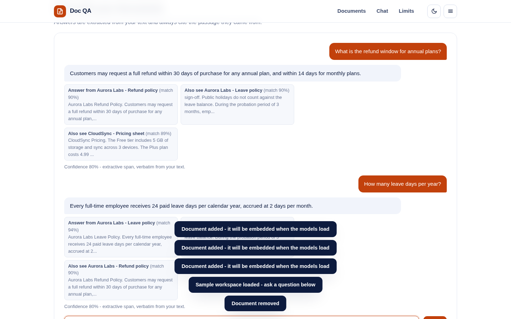
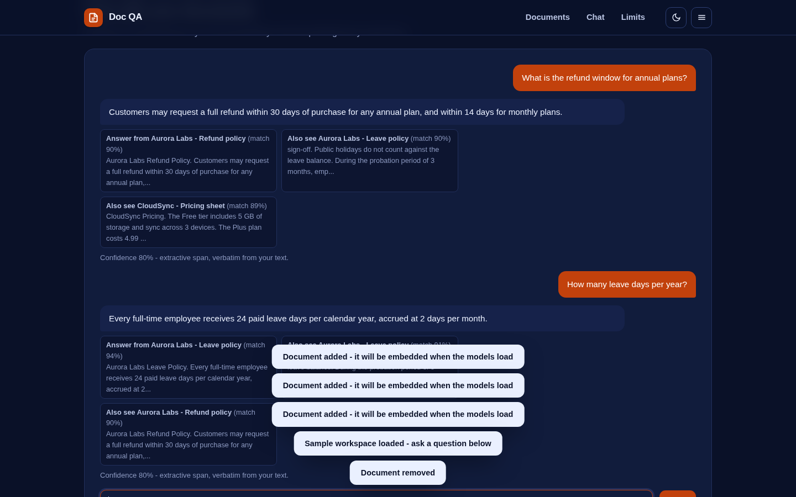

# Doc QA - RAG Chatbot

Ask questions about your own documents and get answers with citations, computed entirely in your browser. No server, no API keys, no uploads.

**Live:** https://akash991833.github.io/doc-qa-rag-chatbot/



## What it does

- Paste text or import `.txt` / `.md` files; a sample workspace (leave policy, refund policy, pricing sheet) is included
- Documents are split into overlapping ~120-word chunks and embedded with **all-MiniLM-L6-v2**
- Each question retrieves the top-3 passages by cosine similarity and answers with **DistilBERT extractive QA** over the best one
- Every answer cites the passage (and document) it came from, with a confidence score
- Dark + light themes, mobile and desktop layouts, installable PWA

## Pipeline

1. **Chunking** - ~120-word passages with 30-word overlap
2. **Embeddings** - MiniLM (23 MB, quantized), mean-pooled and normalized
3. **Retrieval** - cosine similarity, top-3 passages
4. **Answering** - DistilBERT-base-cased-distilled-SQuAD (65 MB, quantized) extracts a verbatim span

Models download once from the Hugging Face CDN and are cached by the browser, so the app works offline afterwards. Both models run through ONNX Runtime WebAssembly (bundled locally - the runtime never needs a network connection, only the one-time model download does).

## Honest limits

- **Extractive, not generative** - answers are exact spans of your text, not fluent summaries
- First question downloads about **90 MB** of models (needs a connection once)
- English documents work best; numbers and dates can confuse the QA model
- Documents live in memory only - reloading the page clears them
- If the answer is not in your documents, the app says so instead of inventing one

## Run locally

Any static file server works:

```bash
python3 -m http.server 8059
# open http://localhost:8059
```

## Tests

```bash
NODE_PATH=/path/to/node_modules python3 -m http.server 8059 &
node tests/run.mjs
```

The suite covers the chunker, cosine math, retrieval ranking, a deterministic end-to-end ask (with stand-in models so CI does not download 90 MB), document removal, both themes and mobile + desktop viewports.


